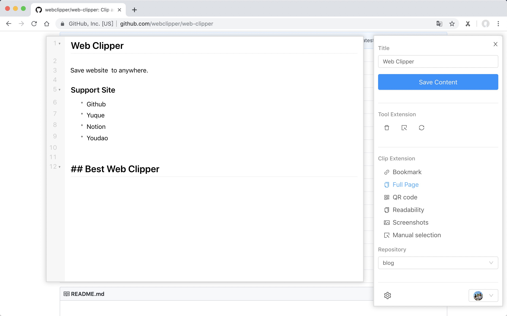

<h1 align="center">Web Clipper</h1>
<p align="center">
  <a href="https://github.com/Zekhi2/web-clipper2/actions/workflows/ci.yml">
    
  </a>
</p>

You can use Web Clipper to save anything on the web to anywhere.

<p align="center">
  
</p>

### Support Site

- [FlowUs](https://flowus.cn/)
- [Obsidian](https://obsidian.md/)
- [Github](https://github.com)
- [Yuque](https://www.yuque.com)
- [Buildin.AI](https://buildin.ai/product)
- [Notion](https://www.notion.so/)
- [Youdao](https://note.youdao.com/)
- [OneNote](https://www.onenote.com/)
- [Bear](https://bear.app)
- [Joplin](https://joplinapp.org/)
- [Server Chan](http://sc.ftqq.com/3.version)
- [dida365](https://dida365.com/)
- [baklib](https://www.baklib-free.com/)
- [wolai](https://www.wolai.com/)
- [Leanote](https://github.com/leanote/leanote)
- [Flomo](https://flomoapp.com/)
- [Siyuan](https://b3log.org/siyuan)
- [Ulysses](https://ulysses.app/)
- [Confluence](https://www.atlassian.com/software/confluence)

### Install

- [Chrome](https://chrome.google.com/webstore/detail/web-clipper/mhfbofiokmppgdliakminbgdgcmbhbac)

- [Edge](https://microsoftedge.microsoft.com/addons/detail/opejamnnohhbjflpbhnmdlknhjkfhfdp)

ps: Because the review takes a week, the version will fall behind.

#### From Github

1. Download the webclipper.zip from [release page](https://github.com/webclipper/web-clipper/releases)
2. Go to **chrome://extensions/** and check the box for **Developer mode** in the top right.
3. Locate the ZIP file on your computer and unzip it.
4. Go back to the chrome://extensions/ page and click the **Load unpacked extension** button and select the unzipped folder for your extension to install it.

### Develop

```bash
$ git clone https://github.com/Zekhi2/web-clipper2.git
$ cd web-clipper2
$ pnpm install
$ pnpm build        # build the extension into dist/chrome
$ pnpm dev          # or: watch mode while developing
```

- Load the `dist/chrome` folder in Chrome / Edge via `chrome://extensions/` with **Developer mode** enabled.

### Test

```bash
$ pnpm test
```

### Feedback

| Type     | Link                                                 |
| -------- | ---------------------------------------------------- |
| Telegram | [Link](https://t.me/joinchat/HoVttRRUIA6aXASixzoqAw) |
